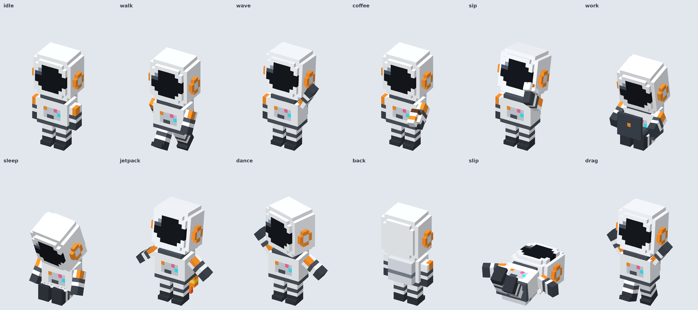
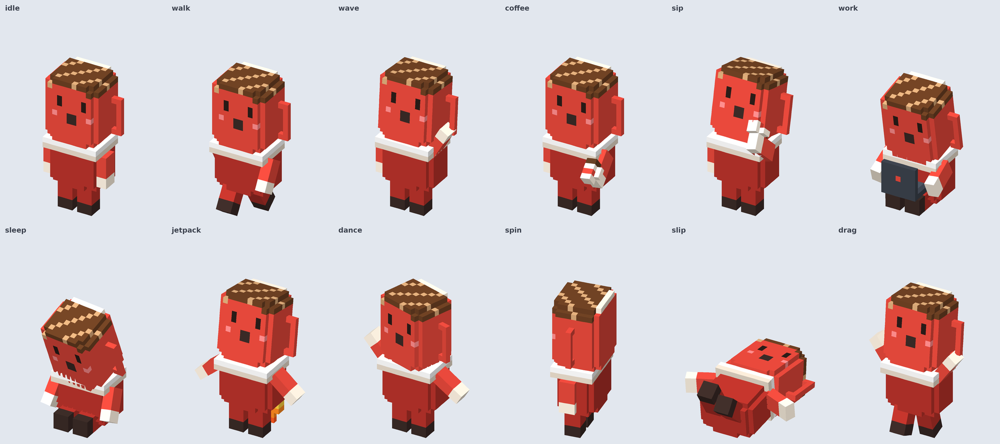
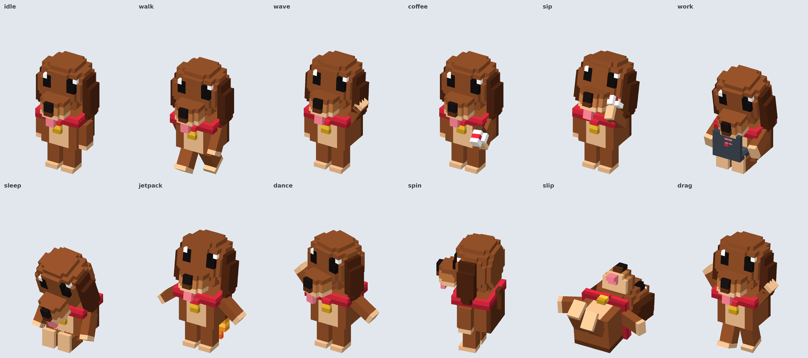

# Mascota de escritorio voxel

Convierte la foto de **cualquier cosa** en una mascota voxel que vive en tu escritorio: tu perro,
el personaje de tu marca, tu producto, un objeto, un logo. Camina sobre la barra de tareas, y al
darle clic abre **Claude** con tu cuenta en un panel a su lado.

## Qué hace la mascota

- **Clic:** abre claude.ai con tu cuenta, tus proyectos y tu historial.
- **Música:** una pestaña controla la app de Spotify. Muestra la canción que suena, y la mascota
  baila mientras hay música.
- **Según la hora:** café en la mañana, recordatorio del almuerzo, bostezos de noche y un despegue
  en jetpack cada hora en punto.
- **Acciones:** bailar, tomar café, jetpack, moonwalk, resbalarse, estirarse, dormir, flotar y mirar el cursor.
- **Arrastrar y soltar:** cae con golpe, levanta polvo y, si la sueltas muy alto, ve estrellitas.
- **Juegos y videos:** se esconde sola cuando hay algo a pantalla completa y vuelve al salir.
- **Tamaño:** se ajusta con la rueda del mouse.

Funciona en **Windows y Mac**.

## Crear tu propia mascota con Claude

1. Descarga `mascota-escritorio.skill` desde [Releases](../../releases).
2. En Claude, ve a **Configuración → Capacidades → Skills** y súbela.
3. En un chat, escribe algo como *"hazme una mascota de escritorio de esto"* y adjunta la foto.

Claude modela el personaje en voxel y revisa todas sus poses. Luego le pone nombre y frases propias,
y te da una vista previa para que la pruebes antes de compilar. Al final te ayuda a sacar los
instaladores.

## Probar a Astro

Astro es el ejemplo incluido. Sus instaladores para Windows y Mac están en [Releases](../../releases).

## Cómo está hecho

- `skill/mascota-escritorio/SKILL.md` — instrucciones para Claude.
- `skill/mascota-escritorio/template/` — la app completa en Electron, con Astro de ejemplo:
  - `engine.js` — motor voxel isométrico, sin imágenes; todo se dibuja con cubos.
  - `character.js` — el personaje. Es lo que cambia en cada mascota.
  - `pet.config.js` — nombre y frases.
  - `pet.js` — comportamiento y animaciones.
  - `main.js`, `panel.*` y `music.js` — ventanas, panel de Claude, Spotify y detección de pantalla completa.
- `skill/mascota-escritorio/examples/` — Cafecito (taza) y Canela (perrita), más ejemplos.

Cada proyecto de mascota trae su propio flujo de GitHub Actions, que compila los instaladores en la nube.

Creado por [ASTROBRAND](https://astrobrand.org).
